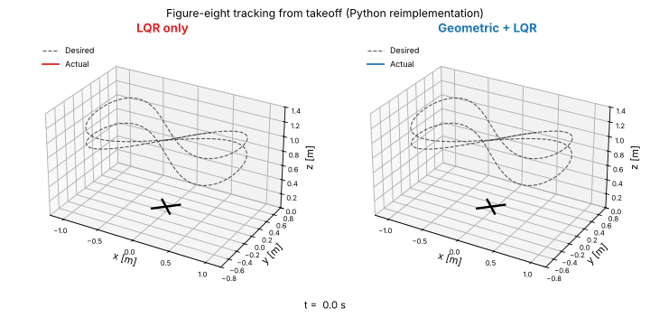
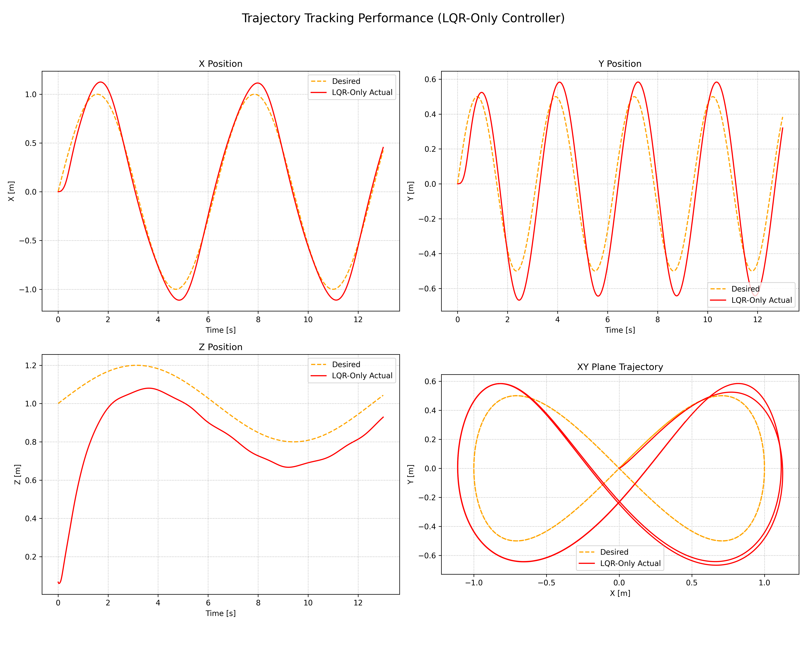
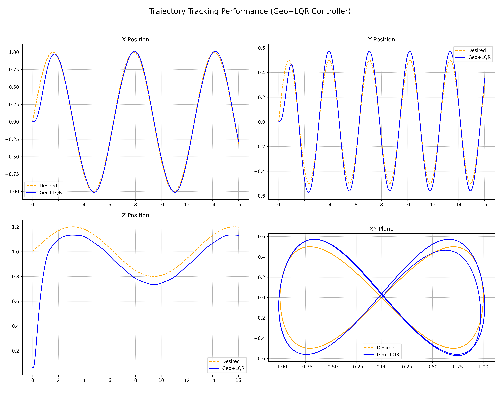
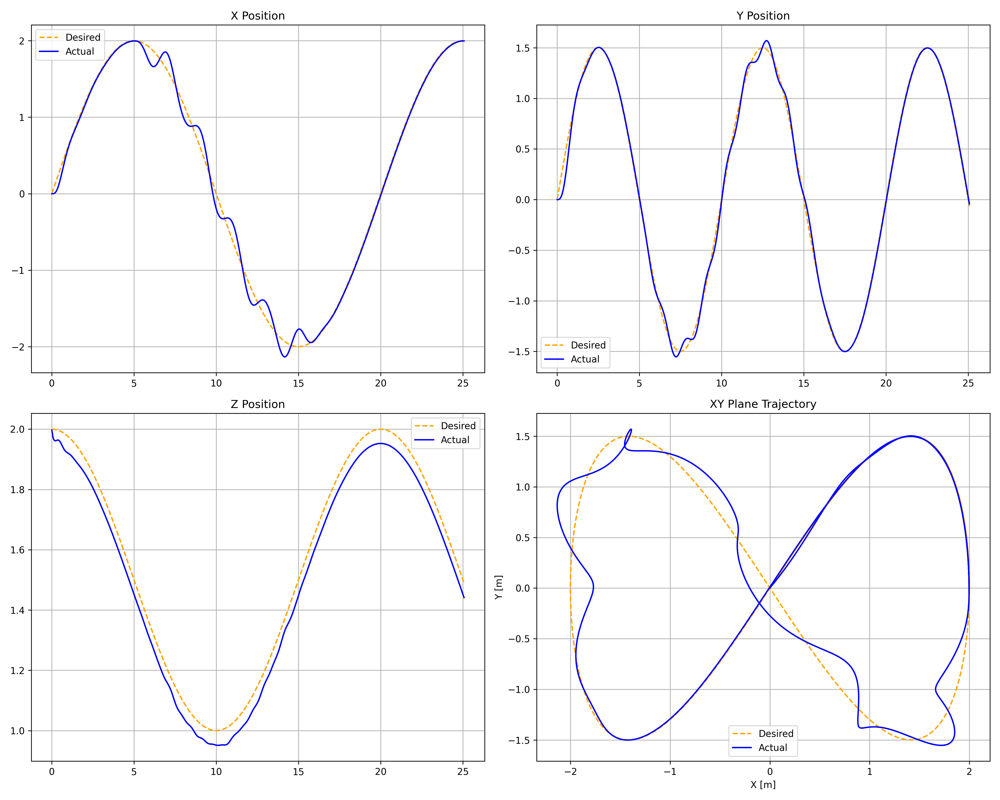
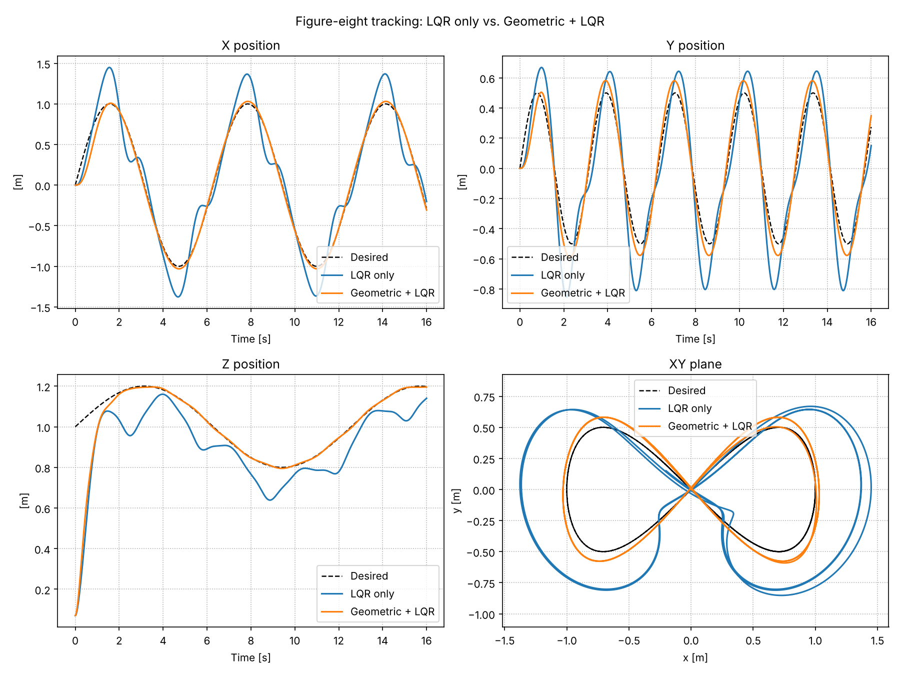
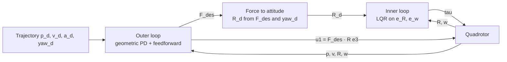

# Geometric + LQR Control of a Quadrotor

Trajectory tracking for a quadrotor with a **cascaded nonlinear controller**: a geometric position controller on SO(3) in the outer loop and an **LQR attitude controller** in the inner loop. It is compared against a single LQR linearised at hover, on an aggressive 3D figure-eight and under sinusoidal wind gusts.

The controller was developed and tested in **NVIDIA Isaac Sim** with the **Pegasus Simulator** (PX4-style Iris quadrotor) as part of the *Design and Simulation of a Morphing Foldable Quadrotor* project at Paderborn University. This repository contains the original Isaac Sim scripts and a **standalone Python reimplementation** that runs on any laptop in a few seconds.



*Same drone, same figure-eight, from takeoff: a single LQR linearised at hover (left) vs. the cascaded geometric + LQR controller (right). Generated with `python_sim/make_animation.py`.*

## Results

### Isaac Sim + Pegasus (original project)

Figure-eight trajectory (x = sin t, y = sin t cos t, z = 1 ± 0.2 m), 1.5 kg quadrotor. The drone takes off from the floor, and the takeoff is included in the metrics.

| Controller | Position RMSE [m] | Velocity RMSE [m/s] | Attitude RMSE [rad] | Max thrust [N] | Max torque x / y / z [N m] |
|---|---|---|---|---|---|
| LQR only (12 states, linearised at hover) | 0.293 | 0.401 | 0.562 | 30.7 | 4.24 / 4.31 / 0.17 |
| Geometric + LQR, aggressive tuning (ωn = 3.0 / 3.2 / 4.0) | 0.191 | 0.358 | 0.244 | 42.2 | 6.16 / 7.17 / 0.49 |
| **Geometric + LQR, final tuning (ωn = 2.2 / 2.9 / 3.5)** | **0.192** | **0.311** | **0.239** | **36.3** | **5.86 / 6.43 / 0.57** |
| Geometric + LQR with sinusoidal wind (4 N / 2 N), larger figure-eight * | 0.121 | 0.363 | 0.257 | 19.9 | 4.75 / 7.98 / 10.93 |

\* Wind test: a larger, slower figure-eight (2 m × 1.5 m, 20 s period, yaw along the path), started in the air at the trajectory's start point, with sinusoidal gusts of 4 N (0.5 Hz) in X and 2 N (0.8 Hz) in Y between 5 s and 15 s. Its numbers are not directly comparable with the rows above.

- The cascaded controller cuts **attitude error by 57%** and **position error by 35%** compared with LQR only.
- The final tuning matches the aggressive tuning's accuracy with **14% less peak thrust and 10% less peak torque**.
- In hover the controller holds position with a steady-state mean absolute error of **2.3 mm (X) and 0.9 mm (Y)**.
- Under a time-varying wind of up to 4 N the controller stays stable and keeps the figure-eight shape. Rejecting the gusts costs control effort: the peak yaw torque rises to 10.9 N m.

| LQR only | Geometric + LQR | With wind |
|---|---|---|
|  |  |  |

### Standalone Python reimplementation

Same controllers, gains, trajectories and wind profile in a simple rigid-body model (no rotor dynamics, no motor limits; wind applied as an external force). The numbers differ from Isaac Sim, but the ranking is the same.

| Experiment | Position RMSE [m] | Attitude RMSE [rad] | Max roll/pitch error [rad] | Max thrust [N] |
|---|---|---|---|---|
| Figure-eight, LQR only | 0.331 | 0.396 | 0.620 | 26.7 |
| Figure-eight, Geometric + LQR, aggressive tuning | 0.151 | 0.247 | 0.394 | 38.2 |
| Figure-eight, Geometric + LQR, final tuning | 0.167 | 0.241 | 0.279 | 32.9 |
| Larger figure-eight with sinusoidal wind | 0.152 | 0.309 | 0.459 | 17.2 |

Full table: [`results/results.md`](results/results.md).



## How the controller works



**Outer loop (position).** A PD law with gravity compensation and acceleration feedforward gives the desired force:

`F_des = -kx e_p - kv e_v + m (a_d + g e3)`, with `kx = m ωn²` and `kv = 2 ζ m ωn` (pole placement, ζ = 1).

**Force to attitude.** The desired body z-axis points along `F_des`; the desired heading sets the x-axis. The collective thrust is the projection `u1 = F_des · R e3`.

**Inner loop (attitude).** The attitude error is computed on SO(3), with no Euler-angle small-angle assumption:

`e_R = ½ (R_dᵀ R − Rᵀ R_d)^∨`, `e_ω = ω − ω_d`

An LQR designed on the double-integrator error model `[e_R, e_ω]` with Q = diag(20, 20, 12, 1, 1, 1.2) and R = diag(0.05, 0.05, 0.06) gives the torque `τ = −K [e_R, e_ω] + ω × Jω`, with

```
K = [[20.0   0     0     4.561  0      0    ]
     [ 0    20.0   0     0      4.561  0    ]
     [ 0     0    14.14  0      0      4.597]]
```

**Baseline.** A single LQR on the full 12-state model (position, velocity, roll/pitch/yaw, body rates), linearised at hover, with Q = diag(10, 10, 15, 0.1, 0.1, 0.1, 5, 5, 8, 0.1, 0.1, 0.1) and R = diag(0.1, 0.5, 0.5, 0.5). It works near hover but degrades in aggressive flight, where the linearisation no longer holds. (The original Isaac Sim file for this baseline was not kept; it is reimplemented in `python_sim/controllers.py`.)

## Repository structure

```
isaac_sim/            Original Pegasus / Isaac Sim scripts: controller backend, wind models, hover / figure-eight / wind runs
python_sim/           Standalone reimplementation: model, controllers, scenarios, experiments
results/              Plots and results table produced by python_sim/run_experiments.py
docs/images/          Plots from the original Isaac Sim runs
```

## Run it

Python simulation (Windows, macOS or Linux, Python 3.9+):

```bash
pip install -r requirements.txt
cd python_sim
python run_experiments.py
```

This prints a report for every experiment and writes the plots and `results.md` to `results/`. `python make_animation.py` regenerates the GIF above.

Isaac Sim + Pegasus: see [`isaac_sim/README.md`](isaac_sim/README.md).

## Project and credits

Developed in the *Automatic Control II* project **"Design and Simulation of a Morphing Foldable Quadrotor"** (Apr–Sep 2025) at the Automatic Control Group (RAT), Paderborn University, by Rachit Kaival Shah, Rayan Adonis Halawi and Neethu Joseph, supervised by Vikas Chidananda and Prof. Dr. Erdal Kayacan.

My part: team lead, the geometric + LQR control design and tuning, and the quadrotor simulation model in Isaac Sim. The morphing (X/H/T/O) Isaac Sim model and the full report are not included in this repository.

Background: T. Lee, M. Leok and N. H. McClamroch, *Geometric tracking control of a quadrotor UAV on SE(3)*, IEEE CDC 2010; D. Falanga et al., *The Foldable Drone: A Morphing Quadrotor That Can Squeeze and Fly*, IEEE RA-L 2019.

## License

MIT, see [LICENSE](LICENSE).
